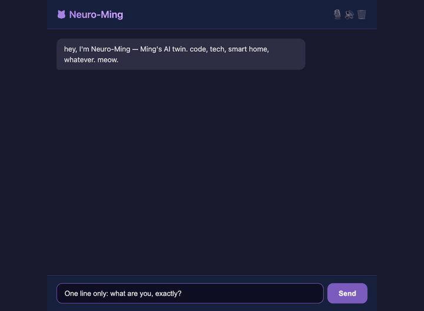
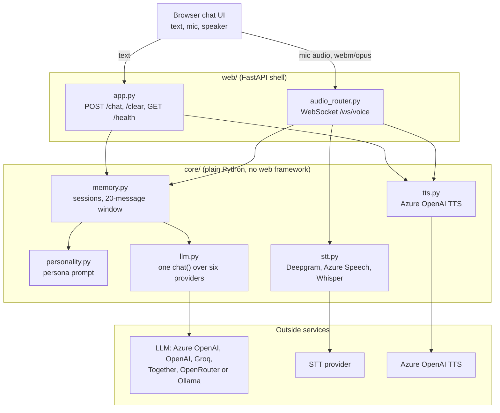
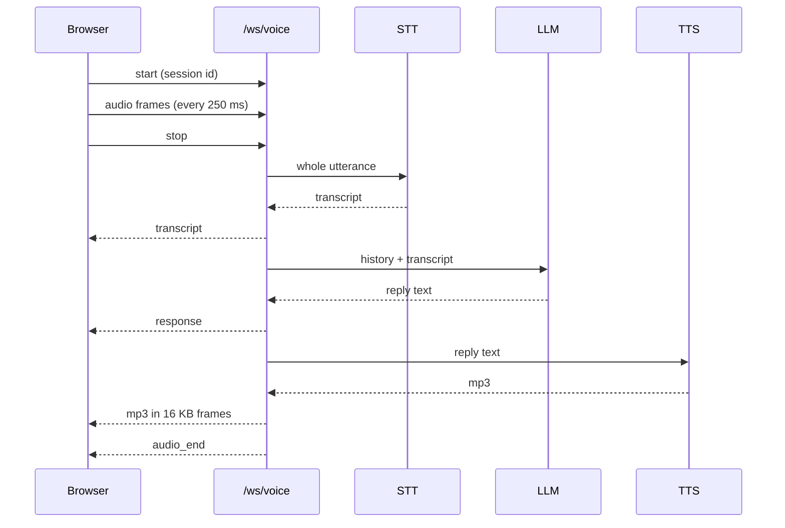

# Neuro-Ming

[](https://github.com/Mingz6/neuro-ming/actions/workflows/ci.yml)
[](LICENSE)

A FastAPI chatbot that talks like me, speaks its answers, and listens through a push-to-talk mic. It is the first stage of an AI VTuber (virtual YouTuber driven by AI).



*The real chat UI, scripted with a headless browser and a fake microphone. The first question is typed, the second is spoken and transcribed on the server.*

## Why it exists

I wanted a stand-in for me that people can talk to, and a reason to build a voice stack end to end. The rule for the project: every milestone has to demo on its own, so the repo is always something you can run. Chat came first, then voice output, then voice input. An avatar, tools and streaming come later (see the roadmap below).

## Quickstart

You need Python 3.11 or newer. The default LLM (large language model) is a local [Ollama](https://ollama.com) model, so the first run costs nothing.

```bash
git clone https://github.com/Mingz6/neuro-ming.git
cd neuro-ming
python -m venv .venv && source .venv/bin/activate
pip install -r requirements.txt
cp .env.example .env
ollama pull llama3.1        # skip if you set another provider in .env
python web/app.py
```

Open http://localhost:8000 for the landing page and http://localhost:8000/chat for the chat UI. `GET /health` returns `{"status":"ok", ...}`.

To use a hosted model, set `LLM_PROVIDER`, `MODEL_NAME` and that provider's key in `.env` (see the comments in `.env.example`).

### Voice

- **Voice output (TTS, text-to-speech):** set `TTS_ENABLED=true`, `TTS_API_KEY` and `TTS_ENDPOINT` for an Azure OpenAI `tts` deployment. The mute button in the UI turns it off per browser.
- **Voice input (STT, speech-to-text):** hold Space or the mic button in `/chat`. Pick a provider with `STT_PROVIDER`:
  - `deepgram` (default): set `DEEPGRAM_API_KEY`.
  - `azure`: set `AZURE_SPEECH_KEY` and `AZURE_SPEECH_REGION`. Needs `ffmpeg`.
  - `whisper` (offline): set `WHISPER_CMD` (a [whisper.cpp](https://github.com/ggml-org/whisper.cpp) binary such as `whisper-cli`) and `WHISPER_MODEL` (a `ggml-*.bin` file). Needs `ffmpeg`.

### Tests

```bash
pip install -r requirements-dev.txt
pytest
```

The suite needs no network and no API keys. A real `ffmpeg` on the path adds one more check.

## Architecture



One voice turn, from key release to sound:



`core/` is plain Python with no web framework in it. `web/` is the thin shell. The text route and the voice route share one session store, so you can type a question, speak a follow-up, and the model remembers both.

## Stack

| Layer | What |
|---|---|
| Server | Python 3.12, FastAPI, Uvicorn |
| LLM | Azure OpenAI (GPT-5.4 with a fallback deployment), OpenAI, Groq, Together, OpenRouter, Ollama |
| TTS | Azure OpenAI `tts` deployment, nova voice, mp3 |
| STT | Deepgram Nova-3 (default), Azure Speech, whisper.cpp |
| Transport | HTTP for text, one WebSocket (`/ws/voice`) for voice |
| Frontend | Plain HTML, CSS and JavaScript. The SolidJS widget on mingz.dev lives in a separate repo |
| Tests | pytest, no network. GitHub Actions runs them on every push and pull request |
| Deploy | A `Dockerfile`. I run it on Azure Container Apps; this repo has no deploy workflow |

## Status

| Milestone | State | What works |
|---|---|---|
| M1 Chatbot with personality | ✅ | Persona prompt, six LLM providers, per-session memory, chat UI |
| M2 Voice output | ✅ | TTS in the chat UI and in the mingz.dev widget, mute and replay |
| M3 Voice input | ✅ | Push-to-talk in `/chat`, STT, same LLM path, spoken reply |

I ran M3 end to end with the offline Whisper provider. A webm/opus recording went in over `/ws/voice`, once from a Python client and once from headless Chrome with a fake microphone, and the transcript, the reply and mp3 audio came back each time. Deepgram and Azure Speech are covered by tests against mocked HTTP responses, not by a live call in this release.

Voice input is in the standalone UI only. The mingz.dev widget has text chat and spoken replies, not a mic button. Per-milestone notes live in [docs/progress.md](docs/progress.md).

## Decisions and trade-offs

- **Plain WebSocket, not Pipecat.** I studied a Pipecat-based voice assistant before M3. Pipecat's local transports assume a desktop or a Raspberry Pi. A browser mic needs a WebSocket, and adding the framework would have meant reworking `web/app.py`. I took the patterns and left the framework. The cost: I write the audio plumbing myself. Pipecat stays on the list for a desktop build ([notes](specs/m3-m4-pipecat-voice.md)).
- **Push-to-talk and one-shot STT.** The server buffers the whole utterance and transcribes it after you let go. It is simple and the transcript is complete. The cost is latency: nothing streams. TTS also returns the whole mp3 before the first byte goes out, so a long reply is a long wait. The Deepgram streaming helper exists in `core/stt.py` but the route does not use it yet.
- **Six LLM providers behind one function.** Ollama and Groq's free tier are for development, Azure OpenAI is for the live site. They all speak the OpenAI chat format, so `core/llm.py` stays small. The cost is the lowest common denominator: no provider-specific features, and a special case because GPT-5 models only accept the default temperature.
- **The STT provider is a setting, not a failover chain.** `STT_PROVIDER` picks one. A cloud outage means no voice input until you change it. Automatic fallback is not built.
- **Browser audio needs converting for two providers.** Deepgram reads the webm/opus the browser records. Azure Speech's endpoint and whisper.cpp want WAV, so `core/stt.py` runs `ffmpeg` first. That adds a system dependency for those two.
- **In-memory sessions, no database.** A 20-message window per session, 30-minute expiry, 200 sessions at most. A restart forgets everyone. That is on purpose until persistent memory is a milestone of its own.
- **No auth.** The deployed backend is for my own site. Every route is open, and the voice route caps one recording at 10 MB. That changes when anyone but me uses it.
- **The persona is a prompt, not a fine-tune.** It is cheap to change and easy to review in a pull request. A test checks that it carries no private names.

## Roadmap

Next three milestones. The full list, M1 to M21, is in [docs/roadmap.md](docs/roadmap.md).

1. **M4 Conversational loop.** A fast model keeps the conversation going while background workers run longer tasks and announce results by voice.
2. **M5 Persona eval harness.** Ground-truth questions, an LLM judge, a banned-phrase check and a score gate in continuous integration, to catch persona drift.
3. **M6 Conversation simulator.** Synthetic multi-turn users that drive the M5 grader.

## License

[MIT](LICENSE)
